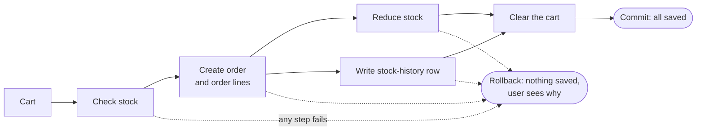
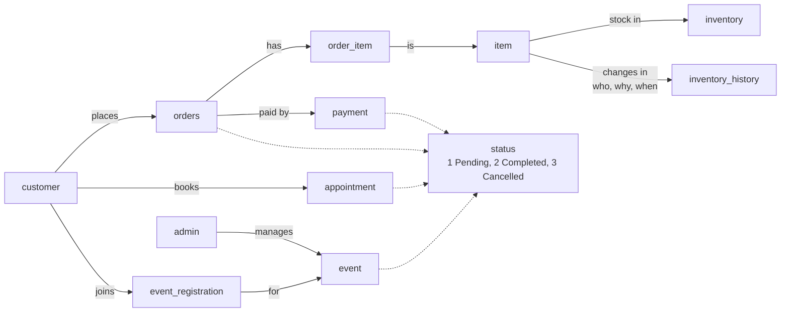

# BTM 495 Project: Online Bike Shop Website

A full-stack bike shop in one command: online checkout, credit card payments, live inventory, events, and a rock-solid SQLite database.


## Quick start

**Step 1. Clone the project**

```
git clone https://github.com/YinLuo2903/BTM495_project.git
cd BTM495_project
```

**Step 2. Run the start script (one line)**

It creates the Python environment if needed, installs frontend dependencies on
first run (`npm ci`), builds the React frontend (`npm run build`), then starts
the Python server and opens `http://localhost:8765/`. Requires Python 3.10 or
newer and npm with Node.js 20.19+ on 20.x, 22.12+ on 22.x, or 24+.

Windows:

```
start.bat
```

macOS / Linux:

```
bash start.sh
```

Press `Ctrl+C` to stop. Add `--no-browser` to skip opening the browser. If the
lockfile changes, delete `frontend/node_modules` (or run `npm ci` in
`frontend`) before the next start.

Optional, for hot reload while editing the frontend: keep the start script
running and, in a second terminal, run `npm run dev` in `frontend`, then open
`http://localhost:5173/` instead.

**Step 3. Try the features in the browser**

**As a customer**

| What to do | How |
| --- | --- |
| Sign in | Click **Sign In** and use `login@example.com` / `1234`. |
| Shop | Open **Items**, add items to the **Shopping Cart**, then check out. |
| Join an event | Open **Events** and register for an event. |
| Book a repair | Open **Appointments** and book a repair appointment. |
| Update your details | Once signed in, click your name to open **My Profile** and edit your details. |
| Create an account | New customers click **Create account** at the top of the home page. |

**As an admin**

| What to do | How |
| --- | --- |
| Sign in | Click **Sign In** and use `admin@lpvr.com` / `123456789`. The admin dashboard opens. |
| See accounts and the schedule | **Customers** lists every registered account. **Dashboard** shows this week's events and appointments. |
| Manage the shop | Create, view, update and delete **Events**, **Appointments** and **Inventory**. |

No real payment is made and card details are never stored.

### Where to find each part

| Part | Address |
| --- | --- |
| Customer site | `http://localhost:8765/views/customer/index.html` |
| Admin dashboard | `http://localhost:8765/views/admin/index.html` |
| Local demo (developer test page) | `http://localhost:8765/` |

Customers and the admin share one **Sign In** page: customers land on the home
page, the admin lands on the dashboard. You stay signed in for 24 hours or
until you click **Sign Out**. Admin accounts can't be created from the website.

### Admin dashboard details

- **Dashboard:** customer count, this month's paid revenue, pending orders and
  upcoming events, plus the weekly table (click an entry to open it).
- **Every section** has search, filters, sortable columns, 15 rows per page
  and a details panel on the right.
- **Images:** events and items accept a JPG, PNG or WebP image up to 2 MB. It
  appears on the customer Events and Items pages.
- **Customers, Orders, Payments** are view and delete only, because they come
  from sign-up and checkout. A customer who still has orders or appointments
  can't be deleted.

API routes behind the admin pages (not protected by a session check in this
local demo):

| Section | Route |
| --- | --- |
| Customers | `/api/admin/customers` (GET, DELETE) |
| Events | `/api/events` (GET, POST, PATCH, DELETE) |
| Appointments | `/api/admin/appointments` (GET, POST, PATCH, DELETE) |
| Inventory | `/api/inventory` |
| Orders, Payments | `/api/dashboard` to list; `/api/orders/<id>` and `/api/payments/<id>` to delete |
| Images | `/api/uploads` (POST); saved in `database/uploads/`, served at `/uploads/` |

### Frontend development

The customer and admin screens are React components in
[`frontend/src`](frontend/src). The Python server serves their Vite build at
the existing `/views/customer/*.html` and `/views/admin/*.html` URLs. The
local demo at `/` is also a React page. The only source HTML is the minimal
Vite entry shell; page content is implemented in TSX.

To build or test the frontend explicitly:

```
cd frontend
npm ci
npm run build
npm test
```

For automatic test reruns while editing, run `npm run test:watch` in another
terminal. `npm test` runs the suite once and exits.

Vite serves the frontend and proxies `/api`, `/assets` and `/uploads` to the Python
server, keeping the demo and frontend on the same origin. If the Python
server uses a different port, set `VITE_BACKEND_ORIGIN` before starting Vite
(for example, in PowerShell: `$env:VITE_BACKEND_ORIGIN='http://127.0.0.1:8766'`).
For a standalone Python-served frontend, run `npm run build` first; this is
not needed when using Vite's development server.

## Run the tests

```
python -m unittest discover -s tests -p "test_*.py"
```

Build the frontend first with `npm ci` and `npm run build` in `frontend` so
the page-serving tests can exercise its generated assets. The last line should
say `OK`. Warning and error log lines in the middle of
the run are expected. The tests use temporary databases, so they do not change
your data.

The frontend test suite covers the session, login, shared layout, customer and
admin pages, and the local demo's primary interactions.

## Optional config

- Fresh database: stop the server, then delete `database/lpvr.db` (and
  `database/uploads/` to remove uploaded images).
- Another port: `start.bat --port 8766` or `bash start.sh --port 8766`.

## Project structure

| Folder / file | Purpose |
| --- | --- |
| `frontend/src/main.tsx` | React entry point; picks the page from the URL |
| `frontend/src/views/customer/` | Customer screens: items, cart, checkout, events, appointments, profile, sign-in and sign-up |
| `frontend/src/views/admin/` | Admin dashboard, sidebar and the shared management table |
| `frontend/src/views/demo/` | Local dry-run dashboard, payment, inventory, and event widgets |
| `frontend/src/components/` | Shared layout and navigation |
| `frontend/src/services/` | API client and login session helpers |
| `frontend/css/style.css` | Shared styles for all website pages |
| `frontend/tests/` | Vite dev-server test (each `*.test.tsx` sits next to its source file) |
| `backend/apis/` | Local website server and application operations (profiles, cart, orders, payments, inventory, events, appointments, admin, image uploads) |
| `backend/models/` | Python classes for users, items, carts, orders, payments, events, appointments |
| `backend/utils/` | SQLite query builder and transactions, validation, logging, responses, table/column/status constants |
| `database/` | `schema.sql` (tables), `sqlite_database.py` (creates and upgrades `lpvr.db`) |
| `tests/` | Website tests; `tests/unitTests/` has the unit tests |
| `start.bat` / `start.sh` | One-line setup and start |
| `run_local_website.py` | Start the website |

Accounts: `createAccount` stores a PBKDF2 password hash, and `login` checks
Admin and Customer accounts by email and password. Passwords must be at least
eight characters (the local demo account `login@example.com` is the only
exception).

### Session API

`POST /api/login` accepts a JSON object with `email` and `password`. On
success it returns `status`, `user`, an opaque `token`, and `expires_at`
(Unix seconds, UTC). Sessions expire after 24 hours; only a SHA-256 hash of
the random token is stored in `user_session`. Expired rows are removed when a
new session is created.

Send `Authorization: Bearer <token>` to `GET /api/session` to check a session
and retrieve its user, or to `POST /api/logout` to revoke it. An invalid or
expired session check returns HTTP 401. Multiple sessions can coexist; logout
revokes only the supplied token. Database initialization adds the table to
existing databases.

The browser stores the bearer token in localStorage and sends it for session
checks and logout; the session persists across reloads and expires after 24
hours. A 401 clears the stored token; network or server errors are displayed
without silently discarding it.

This is a local demo, not production authentication: other pages and APIs are
not protected, even when a session exists. Do not expose this server or its
demo account publicly. Any script executing on the site can read localStorage
tokens, so an XSS vulnerability could expose them. Production use requires
HTTPS, authorization on protected endpoints, additional security controls,
and safer browser session storage such as HttpOnly, Secure, SameSite cookies
with CSRF protection.

## Details

**Checkout.** All steps run in one transaction: either all are saved or none.



**Data model.** Events, appointments, orders, and payments share one `status`
table: `1 Pending`, `2 Completed`, `3 Cancelled` (see `StatusID` in
`backend/utils/constants.py`).



## Contribution
Except for repo admins, everyone else needs to work on a local branch and open a PR.
