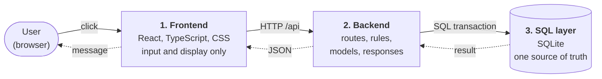

# BTM 495 Project: Online Bike Shop Website

A full-stack bike shop website: online ordering, process payment with credit card, manage inventory/repair appointments/events, and SQLite database. The platform porvides a centralized database and a admin dashboard to streamline business operation.



## Quick start

**Step 1. Clone the project**

```
git clone https://github.com/YinLuo2903/BTM495_project.git
cd BTM495_project
```

**Step 2. Run the start script (one line)**

It creates the Python environment if needed, installs frontend dependencies on
first run (`npm ci`), builds the React frontend (`npm run build`), then starts
the Python server and opens `http://localhost:8765/`. Requires Python 3.10 or
newer and npm with Node.js 20.19+ on 20.x, 22.12+ on 22.x, or 24+.

Windows:

```
start.bat
```

macOS / Linux:

```
bash start.sh
```

## Running the Application

1. Run the start script to launch the application.
2. The website will automatically open in your browser.
3. Press `Ctrl + C` in the terminal to stop the application.

**Step 3. Try the features in the browser**

### Where to find each part

| Part | Address |
| --- | --- |
| Customer site | `http://localhost:8765/views/customer/index.html` |
| Admin dashboard | `http://localhost:8765/views/admin/index.html` |
| Local demo (developer test page) | `http://localhost:8765/` |

Customers and the admin share one **Sign In** page: customers land on the home
page, the admin lands on the dashboard. You stay signed in for 24 hours or
until you click **Sign Out**. Admin accounts can't be created from the website.

**As a customer**

| What to do | How |
| --- | --- |
| Create an account | New customers click **Create account** at the top of the home page. |
| Sign in | Click **Sign In** and use `login@example.com` / `1234`. |
| Shop | Open **Items** to browse or search for products, add items to the **Shopping Cart**, and proceed to checkout and payment. |
| Join an event | Open **Events** to view upcoming events and register for an event. |
| Book a repair | Open **Appointments**, select an available time slot, describe the bike issue, and confirm the booking. |
| Update profile| Once signed in, click your name to open **My Profile** and edit your personal information. |


**As an admin**

 What to do | How |
| --- | --- |
| Sign in | Click **Sign In** and use `admin@lpvr.com` / `123456789`. The admin dashboard opens automatically. |
| dashboard | The **Dashboard** shows an overview of shop activities, including upcoming events and appointments. |
| customers | Open **Customers** to view registered customer accounts and their information. |
| events | Open **Events** to create, view, update, or delete events. |
| appointments | Open **Appointments** to view, create, update, or delete repair bookings. |
| orders | Open **Orders** to view customer orders, including purchased items, order details, and status. |
| payments | Open **Payments** to view payment records, including amounts, payment methods, and payment status. |
| inventory | Open **Items** to add, view, update, or delete shop items and their details. |

No real payment is made and card details are never stored.

## Contribution
Except for repo admins, everyone else needs to work on a local branch and open a PR.

## License
The source code is released under the [MIT License](LICENSE).

The photos and logo are not covered by the MIT License. The shop's logo and photos belong to
Le Petit Vélo Rouge, two photos belong to Ivan de Jacquelin / The Link, and the sample
item and event photos come from Wikimedia Commons under Creative Commons licenses or the public domain. See
[THIRD_PARTY_NOTICES.md](THIRD_PARTY_NOTICES.md) for every file and its terms; the website
shows the same credits on its **Photo credits** page (linked in the footer).
